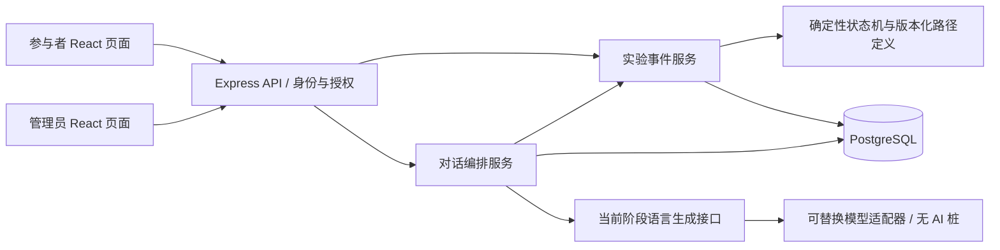

# 系统与模块架构

## 范围和边界

本版本使用独立代码、数据库、账号、环境变量、模型配置和部署资源。禁止读取或写入 WorkBuddy 生产系统。设计阶段不创建账号、不部署、不调用模型。

参与者通过实验账号进入已分配的路径与 Agent；管理员创建账号、分配条件、配置路径、查看状态和导出数据。实验条件由服务器读取，参与者不能通过请求参数切换条件或 Agent。

三部分职责严格分离：

| 部分 | 输入与输出 | 权限 |
| --- | --- | --- |
| 实验状态机 | 当前状态、显式事件、持久化变量 → 新状态与待保存变量 | 唯一可决定阶段迁移的业务组件 |
| 对话编排 | 用户消息 → 保存记录、提交获准事件、安排生成、返回结果 | 通过实验事件服务操作状态，不能绕过状态机 |
| 语言生成 | 当前阶段说明、必要上下文 → 一段文本 | 无数据库、迁移、工具调用或变量写入权限 |

## 一次交互的处理顺序

1. 校验身份、参与者所属关系、请求结构与幂等键。服务器查找当前实验、条件、Agent 和状态。
2. 在短数据库事务内锁定实验状态，核对版本，保存用户输入或问卷回答，由状态机检查事件和迁移守卫；保存状态、变量、审计事件以及待生成的助手记录。
3. 提交事务后，以已保存的状态版本和当前阶段上下文调用生成接口；调用期间不持有数据库锁。
4. 校验输出类型、长度及实验内容约束，在新事务中将输出写入对应助手记录。模型结果不能修改状态或 Path_Data。
5. 前端按服务器返回的状态展示当前任务。超时或失败显示可重试状态；重试复用原记录，不重复推进阶段。

一个会话最多保留一个正在生成的回合。重复请求返回已有结果；相同幂等键但不同载荷返回冲突。恢复任务重试过期的生成租约。停止或人工终止时递增状态版本，迟到的输出保留审计但不作为有效回复展示。

状态推进可以早于语言生成完成，因为推进依据是参与者提交的有效事件。新的参与者操作在待生成回合完成或获准取消前被阻止，避免显示与阶段不一致。

## 前端模块

| 模块 | 主要内容 |
| --- | --- |
| participant/auth | 实验编号与密码登录、退出、会话过期 |
| participant/experiment | 服务端阶段展示、任务说明、表单、评分、确认操作、恢复会话 |
| participant/chat | 消息列表、发送状态、生成中、失败重试；不包含阶段决策 |
| admin/participants | 编号创建、账号重置、条件和 Agent 分配 |
| admin/experiments | 路径草稿、版本发布、参数校验与分配前检查 |
| admin/observations | 对话、变量、状态和迁移审计的授权查看 |
| admin/exports | 按实验筛选、导出任务和审计 |
| shared | 类型化 API 客户端、通用组件、表单校验、错误与权限展示 |

前端可以使用服务端提供的 `allowed_actions` 呈现按钮，但后端仍对每次请求重新校验。

## 后端模块

| 模块 | 主要内容 |
| --- | --- |
| auth / authorization | 参与者与管理员独立角色、密码哈希、会话、请求权限 |
| participants / assignments | 编号、条件、Agent、已发布实验版本绑定 |
| experiment-definitions | 三条路径的类型化定义、配置校验、不可变版本发布 |
| state-machine | 纯状态迁移函数、事件、守卫、变量校验；无网络调用 |
| experiment-service | 数据库事务、并发控制、事件幂等、状态与变量持久化 |
| conversations | 回合编排、消息记录、生成租约、恢复与重试 |
| generation | `LanguageGenerator.generate(StageGenerationContext)` 接口及适配器 |
| admin / exports | 后台查询、人工终止、CSV/JSON 导出与权限审计 |
| persistence | PostgreSQL 迁移与查询，不承担实验规则 |

建议使用 npm workspaces：`apps/web`、`apps/api`、`packages/contracts`、`packages/experiment-core`。contracts 放 API 数据结构；experiment-core 放纯状态机，前端不直接运行其迁移逻辑。目录仅为后续实现建议，本轮不创建空应用。

## 模型接口与上下文

`StageGenerationContext` 只包含当前阶段目标、语言风格、已发布 Agent 设定、必要且经过筛选的变量、受限的近期对话和输出约束。上下文生成器通过当前状态查找模板，不发送完整流程、未来阶段、迁移表、管理接口或凭据。

无 AI 阶段由固定文本桩实现同一接口；之后增加供应商适配器，供应商名称、模型标识、超时等独立配置。DeepSeek 可作为一种适配器，不成为系统依赖。供应商原始返回值由适配器归一化为文本与调用元数据；文本中即使包含“切换阶段”或 JSON 指令也没有执行入口。

生成式文本可能偏离实验语义。结构校验不能证明模型始终遵守当前阶段；后续需要分阶段语义评估与违规输出的拒绝/回退策略。未通过当前阶段规则的输出不得作为有效实验回复交付，且不能通过重试修改实验条件。

## API 边界草案

| API | 用途 |
| --- | --- |
| `POST /api/participant/login` | 实验账号登录 |
| `GET /api/participant/session` | 获取本人状态、允许操作和已保存消息 |
| `POST /api/participant/session/messages` | 当前会话发送消息，必带幂等键与状态版本 |
| `POST /api/participant/session/events` | 提交当前阶段允许的结构化事件，如评分和确认 |
| `POST /api/participant/session/generations/:id/retry` | 重试本人已失败生成，不迁移状态 |
| `POST /api/admin/participants` | 创建编号与账号 |
| `POST /api/admin/participants/:id/assignment` | 在会话启动前分配发布版本、条件、Agent |
| `POST /api/admin/experiment-versions` | 创建/发布通过校验的配置版本 |
| `GET /api/admin/sessions/:id` | 授权查询状态、变量、对话、审计 |
| `POST /api/admin/sessions/:id/terminate` | 提交有理由的人工终止事件；不能任意设置阶段 |
| `POST /api/admin/exports` | 创建带实验版本信息的授权导出 |

## 研究数据与运行边界

实验编号与真实身份分离；默认不采集真实姓名等身份信息。密码使用成熟哈希实现，绝不导出。日志避免包含完整对话和凭据；研究对话只进入受权限控制的记录。

上线前确定知情同意、退出机制、研究数据保留期限、导出权限和模型供应商的数据处理范围。使用独立测试数据开展开发与测试。模型服务中断不丢失已提交消息、评分或状态；刷新页面从数据库恢复。
