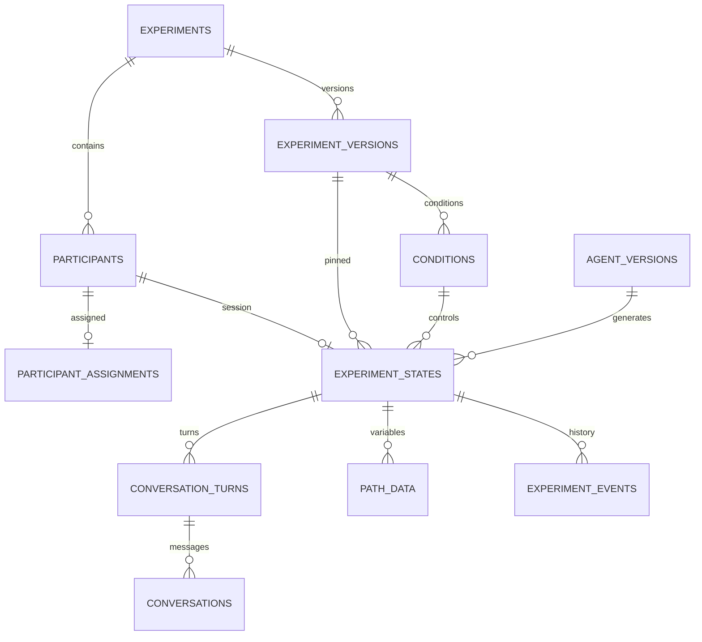

# 数据库设计

PostgreSQL 为唯一实验事实来源。下表是逻辑设计，尚未生成 SQL 或迁移。物理名称采用 snake_case；UUID 主键，时间为 timestamptz，关键表记录 created_at/updated_at。

## 核心实体

| 实体 / 表 | 字段与职责 |
| --- | --- |
| Participant / participants | id、experiment_id、participant_code、password_hash、account_status；编号在实验内唯一 |
| Experiment_State / experiment_states | id（会话 ID）、participant_id、experiment_version_id、condition_id、agent_version_id、path_type、stage、lifecycle、version、stage_entered_at、started_at、completed_at、terminated_reason；一个参与者一个实验会话为第一版默认 |
| Conversation / conversations | id、state_id、turn_id、sequence、role、content、status、generation_context_version、provider、model、prompt_template_version、attempt_count、lease_until、error_code、created_at、completed_at |
| Path_Data / path_data | id、state_id、variable_key、value_json、schema_version、source_event_id、recorded_stage、revision、recorded_at；保存关键变量的版本化记录 |

`Experiment_State` 同时作为实验会话根；第一版 participant 已属于一个 experiment，不再允许跨实验复用账号。将来支持重测时增加显式 attempt，不覆盖原会话。

## 支撑实体

| 表 | 用途与约束 |
| --- | --- |
| experiments | 研究项目 ID、名称、状态与说明 |
| experiment_versions | experiment_id、版本号、draft/published、path_definition_json、parameter_schema_json、definition_hash、published_at；发布后不可修改 |
| conditions | experiment_version_id、条件代码、path_type、固定参数；版本内条件代码唯一 |
| agent_versions | 实验归属、Agent 版本、当前阶段风格配置与人物设定；发布后不可修改 |
| participant_assignments | participant_id、发布版本、condition_id、agent_version_id、assigned_by；参与者唯一，会话启动后不可改写 |
| experiment_events | state_id、event_type、from_stage、to_stage、from_version、to_version、actor_type、actor_id、idempotency_key、payload_hash、validated_payload_json、result_json、created_at |
| conversation_turns | state_id、idempotency_key、request_hash、accepted_state_version、status、created_at；每个已接受用户交互一个回合 |
| admin_users / admin_audit_logs | 管理员身份、操作对象、动作、原因与时间；账号密码不进入审计 |

## 数据完整性

- 分配与会话必须指向同一实验的已发布版本；条件必须属于该版本。使用复合外键约束归属关系，事务内检查发布状态。
- participants 的 `(experiment_id, participant_code)` 唯一；experiment_states 的 participant_id 唯一。
- events 与 turns 各有 `(state_id, idempotency_key)` 唯一约束。同一 API 类型的重试读取原结果，不重新执行。
- conversations 的 `(state_id, sequence)` 唯一；sequence 在锁定会话事务内分配。第一版每个回合最多一个 user 记录和一个有效 assistant 记录，重试更新同一 assistant 槽并保留尝试审计。
- stage 合法值和 path_type 由版本定义验证；lifecycle 限定 assigned/active/completed/terminated。condition、Agent 和路径不得在 active 后变更。
- path_data 的 `(state_id, variable_key, revision)` 唯一，按 revision 读取最新值。value_json 受版本化 schema 校验，不能作为未校验的任意 JSON 容器。
- path_data.source_event_id 必须来自同一会话，使用复合外键；事件写入、变量写入、状态推进在同一事务内完成。旧变量保留，不就地覆盖原始评分。
- 关键结果通过专用 variable_key 分开存储，避免把全部研究数据埋入聊天文本。应用角色限制数据库写权限，服务层集中执行迁移。

## 各路径变量（初始提案）

| 路径 | 变量 |
| --- | --- |
| 认知 | stereotype_text、confirmed_viewpoint、initial_rating、reframe_1_response … reframe_4_response、second_rating、action_intention |
| 情感 | persona_snapshot、first_contact_response、misunderstanding_response、resolution_response、shared_experience_response、relationship_response、ending_feedback |
| 日常 | control_chat_turn_count、ending_feedback（仅研究方案明确要求时采集） |
| 共用 | condition_snapshot、agent_snapshot、consent_version/consent_at（若研究要求）、退出原因、阶段完成时间 |

评分保存为 `{instrument_id, instrument_version, items, responses}`。量表、分值范围、必填项、行动意愿是否为量表尚未确定，发布配置前必须明确；不默认使用任何具体心理学量表。初次评分与二次评分分别存储，禁止覆盖。

实验关键内容来自参与者明确提交的字段与后端确定性规则。模型推测不能成为实验事实；需要模型辅助提取时只能保存为候选内容，必须让参与者确认后提交事件。

## 并发、恢复、导出

迁移事务使用 `SELECT … FOR UPDATE` 锁定 state，结合客户端 expected_version 校验；每个接受的可变事件递增 version，包括同阶段消息。版本冲突返回 409，前端重新读取状态，不自动重放评分。

生成任务以 conversations 的 pending/generating/ready/failed/cancelled 状态与租约恢复。外部请求可能重复，数据库中只有一个被接受的回复；没有供应商幂等支持时不保证外部请求或计费仅一次。

常用索引：states(participant_id)、states(experiment_version_id,lifecycle)、conversations(state_id,sequence)、events(state_id,created_at)、path_data(state_id,variable_key,revision DESC)、待生成记录(status,lease_until)。

导出包含实验版本、条件、Agent 版本、路径、阶段与时间、消息角色、变量版本、迁移记录及生成失败标记。使用一致性读取快照，避免同一导出中状态与变量来自不同时间点；CSV 防止公式注入。默认不含账号密码、会话凭据或供应商密钥。
