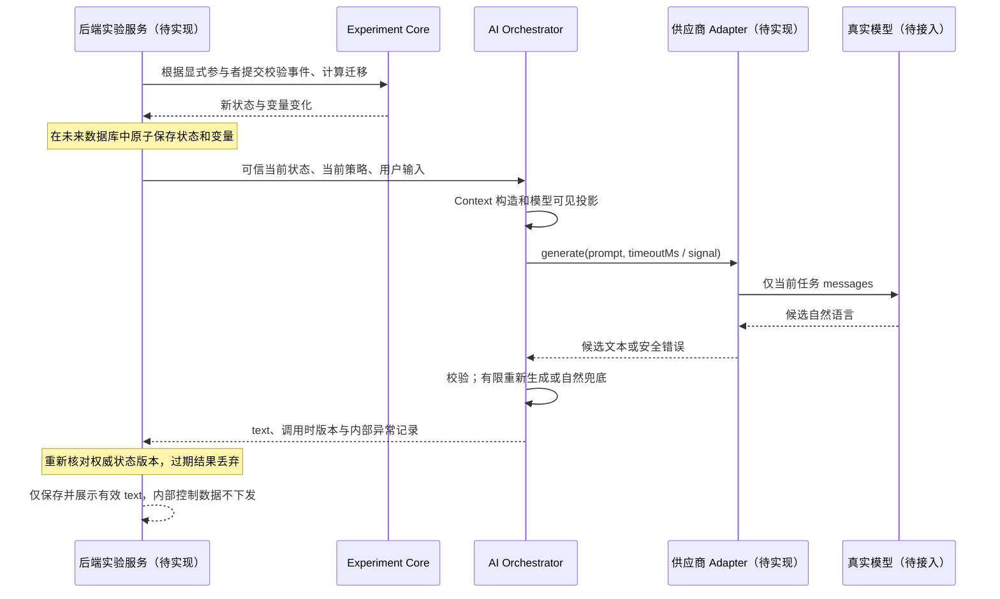

# Model Adapter 设计与实验接口边界

本轮实现公共 LanguageGenerator 接口、独立 packages/model-adapter/ 的 MockAdapter，以及实际生效的超时和取消控制。OpenAI Compatible Adapter 和 DeepSeek Adapter 是下一轮设计，本轮没有 HTTP 客户端、真实供应商请求或模型密钥。

## 已实现的契约

```typescript
interface GenerationOptions {
  readonly timeoutMs?: number; // 每次生成 1–60000ms，默认 10000ms
  readonly signal?: AbortSignal;
}
interface LanguageGenerator {
  generate(prompt: PromptBundle, options?: GenerationOptions): Promise<unknown>;
}
```

Orchestrator 只依赖 LanguageGenerator。MockAdapter 可接收固定文本或本地异步 responder，用于成功、异常、无效输出和不返回结果的测试。Adapter 不获得 state、definition、事件回调、变量写入接口或数据库连接；其唯一实验输入是已投影的模型可见 Prompt。

```text
packages/model-adapter/
  src/index.ts               MockAdapter，复用语言接口与截止时间控制
  tests/interface.test.ts    21 个模型接口测试
  examples/acceptance.ts     三条完整 mock 流程、替换与失败调用记录
  package.json
  tsconfig.json
  tsconfig.tests.json
```

依赖方向为 model-adapter → ai-orchestrator（复用契约和超时工具）。ai-orchestrator 不依赖任何具体 adapter 或供应商；experiment-core 不依赖二者。未来可以把公共语言契约抽到单独包，但本轮不为了抽象同时修改 contracts 或状态机。

## 下一轮供应商实现方案（尚未实现）

| 实现                    | 配置与职责                                                                       | 实验系统可见行为                 |
| ----------------------- | -------------------------------------------------------------------------------- | -------------------------------- |
| MockAdapter             | 本地固定文本或异步 responder，无网络                                             | 已实现 generate(prompt, options) |
| OpenAICompatibleAdapter | 可信配置的 HTTPS baseURL、模型 ID、密钥绑定、输出预算；发送 messages；归一化响应 | 下一轮实现相同 LanguageGenerator |
| DeepSeekAdapter         | 在兼容 adapter 上提供经过验证的默认地址和模型配置                                | 下一轮实现相同 LanguageGenerator |
| 其他供应商 adapter      | 在统一接口后处理不同请求和响应协议                                               | 不影响状态机和当前阶段策略       |

供应商配置由服务端显式依赖注入，不从参与者输入或模型回复读取。密钥仅保存在云环境或部署平台的安全配置中，不进入 Git、Prompt、参与者响应或错误日志。模型选择不需要修改实验定义。

真实 adapter 只发送 prompt.messages；不把整个请求、后端 Context 或 OrchestrationResult 序列化成供应商请求。采用一次非流式调用，先完整校验再展示；本轮不设计直接把未经校验的 token 流给参与者。

建议配置包含 provider、baseURL、model、maxOutputTokens 和研究者批准的生成参数。timeoutMs / signal 已是公共运行选项；temperature、输出预算等供应商参数在下一轮明确语义后放入可信配置，不能由模型决定。

失败分类需覆盖连接失败、401/403、429、5xx、无效响应格式、非文本回复、超时、取消。供应商错误只保留安全分类和关联信息，不能把原始响应或密钥输出给参与者。Adapter 默认单次请求，不叠加隐藏供应商重试；Orchestrator 统一控制 1–3 次预算，避免重试乘法。

## 超时、取消和迟到结果（已实现）

runGeneration 设置截止时间，创建 AbortController，连接外部取消信号，附加 promise 成功与失败处理，完成后清理计时器和监听器。Orchestrator 的外层截止时间即使遇到不响应 signal 的自定义生成器，也能结束等待并丢弃迟到输出。MockAdapter 单独调用时同样遵守 options。

默认每次最多等待 10000ms，默认总共尝试 2 次。超时记录 GENERATOR_TIMEOUT，预算用尽后进入自然兜底；外部取消记录 GENERATOR_ABORTED，并停止重试。调用方通常应丢弃已取消请求的展示结果，兜底返回不代表可以继续向已断开的参与者发送消息。

取消只是通知下游停止；无法证明不合作的实现停止计算。真实 adapter 必须把 signal 转发给 fetch，并通过实际 HTTP 测试验证取消、错误归一化和资源回收。当前测试没有验证供应商收费或真实网络停止。

当前异常记录通过返回 auditEvents 或可选 auditSink 交给后端，未实现管理员查询和数据库持久化。auditSink 为可信调用方提供；其自身超时与可靠投递不属于模型截止时间的保证。

## 下一轮实际模型调用顺序（设计流程）



模型回复绝不反向触发 transition。INITIAL_RATING 到重构、SECOND_RATING 到行动意愿都必须通过后端显式事件。数据库原子写入、版本再核对、登录与 API 业务仍待实现，不能把设计流程写成现有在线系统能力。

## 上线前尚需验证

真实 HTTP 协议和响应形状、鉴权、限流、超时取消、费用与预算、过期回复处理，以及研究者批准的评分尺度、人物设定、场景动作和阶段语义评估。当前文本规则不能证明任意模型回复都满足实验目标、唯一评分对象与允许动作语义。测试通过证明的是已列出的工程边界和回归场景。
