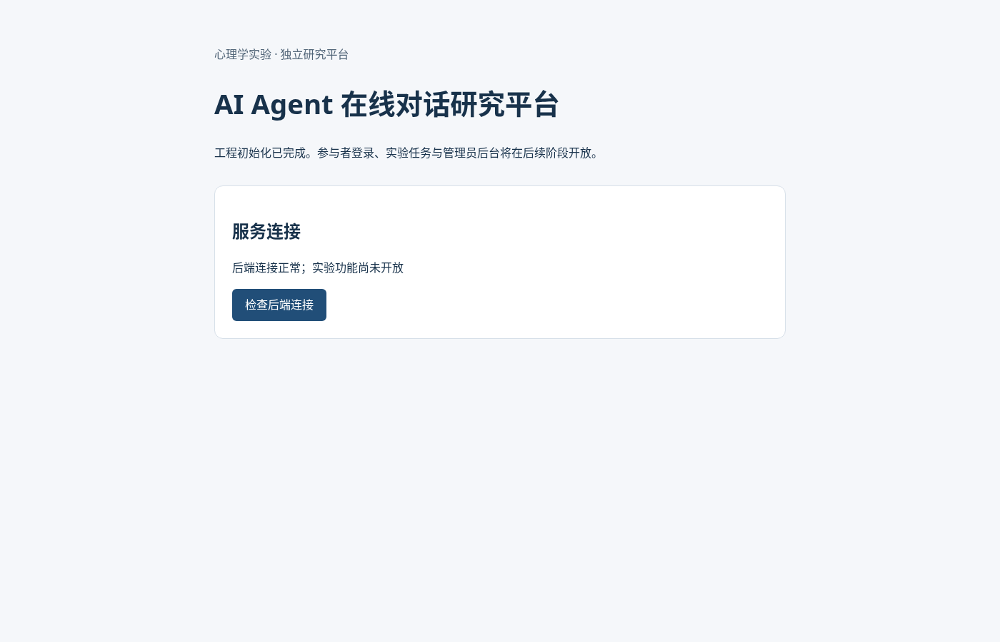

# 第二轮成果：工程初始化与真实首页截图

本轮完成上传开发指令中的 Step 1：TypeScript monorepo、React/Vite 前端骨架、Express 后端骨架、基础测试与工程检查。第一轮四份研究设计文档保留，尚未实现实验业务。

## 首页截图

以下图片来自实际 Chromium 浏览器。截图前点击了页面的“检查后端连接”按钮，页面显示“后端连接正常；实验功能尚未开放”。图片不是概念设计或模型生成图。

## 成果入口

- [工程运行说明与目录结构](../README.md)
- [Step 1 文件清单、测试与验收记录](step1-report.md)
- 前端：apps/web
- 后端：apps/api
- 共用类型：packages/contracts
- 状态机领域模块骨架：packages/experiment-core
- 工程检查与 CI：根目录配置和 .github/workflows/ci.yml

自动化检查已在云环境执行：类型检查、ESLint、Prettier、2 个 API 测试及四个工作区构建通过；npm install 与锁文件重装 npm ci 通过。开发和构建模式的服务请求均通过。截图制作时额外验证了真实浏览器的首页加载和连接按钮交互。

此处的浏览器检查仅覆盖首页连接按钮，不是实验流程端到端测试。远端 CI 的执行结果应另在 GitHub Actions 查看。

## 从 GitHub 下载

仓库：https://github.com/qianmengyan008-sys/AI-Agent-Research-Platform

1. 下载整个项目：打开仓库，在 Code 页面点击绿色 Code 按钮，选择 Download ZIP，解压后可看到源码、文档和图片。私有仓库需要先登录有权限的 GitHub 账号。
2. 下载图片：进入 docs/images/research-platform-home.png，打开图片原始内容（Raw / Download raw file），然后保存图片。
3. 查看第二轮材料：打开本页或 docs/step1-report.md；Markdown 文档可以直接在 GitHub 阅读并复制给 GPT。
4. 本地开发：安装 Node.js 24 和 npm 11，在解压目录执行 npm ci、npm run check；在两个终端分别运行 npm run dev:api 和 npm run dev:web。

ZIP 不包含 node_modules、缓存或构建产物；这些可以通过锁文件安装和构建命令复现。截图为静态图片，不是在线应用；当前没有对公网部署。
