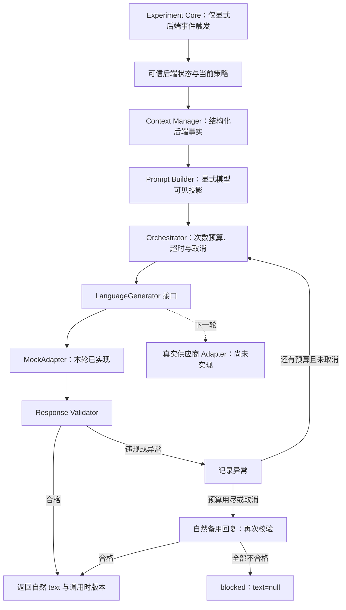
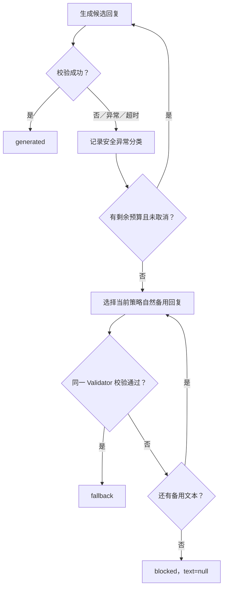

# 第六轮反馈：Step 4 模型接入前验收与实验接口成果

供 GPT 复核并指导 Codex 下一轮开发。依据 [用户上传需求原文](inputs/sixth-round-requirements.docx)，本轮完成模型接入前的接口强化与 Mock Adapter 验收，不接入真实模型。整个项目归档包含此反馈的 Markdown / Word 版本及本轮验收记录。

## 本轮结论、原因与范围

已实现独立 packages/model-adapter/ 的 MockAdapter，实验系统仍只依赖 LanguageGenerator。补齐 generate(prompt, options) 的超时和取消契约；即使生成器不理会取消，编排层也会结束等待并丢弃迟到结果。替换生成器、模型失败、超时和错误回复均不会由编排层推进状态或修改实验变量。

复核后将 Context 的后端实验事实和模型可见信息明确区分。扩展初次评分的阶段一致性检查、确认后变量保护、已坐下的食堂场景回退检查，以及兜底后台话术拦截。真实 OpenAI Compatible / DeepSeek adapter 仅设计，未实现或运行。

未修改 experiment-core、contracts、前端、API 业务或数据库；没有创建用户系统、聊天页面、管理后台或数据库迁移。状态机定义、事件和评分变量保持原样。新的评分锚定规则和备用话术属于语言约束变化，需要研究者审核正式刺激材料；不能据此宣称实验有效性已通过验证。

修改文件：ai-orchestrator 的 types、context-manager、prompt-builder、response-validator、stage-policies、orchestrator、index，新增 generation.ts；更新完整路径示例以允许注入生成器，调整迟到结果测试的异步启动等待，新增 round6.test.ts。另新增 model-adapter 的源码、接口测试、示例与配置；更新根工作区、TS 引用、Vitest、构建顺序、锁文件和 README。锁文件只增加本地工作区链接，没有新增第三方依赖。

## 1. 当前 AI Orchestrator 架构图



不存在模型回复 → transition 的调用路径。实验状态迁移在后端模拟器中显式发生，模型关键词只决定语言回复是否被拒绝。

## 2. Model Adapter 设计方案

完整说明见 [Model Adapter 设计](model-adapter-design.md)。当前接口：

```typescript
interface LanguageGenerator {
  generate(prompt: PromptBundle, options?: GenerationOptions): Promise<unknown>;
}
interface GenerationOptions {
  readonly timeoutMs?: number;
  readonly signal?: AbortSignal;
}
```

MockAdapter 接收固定文本或异步 responder，支持超时与取消；供应商 adapter 未来通过同一接口替换。编排层不知道具体供应商，没有模型状态写入接口、工具调用接口或事件回调。

默认每次 timeoutMs=10000，允许整数 1–60000；默认 maxAttempts=2，允许 1–3。Adapter 单独调用和 Orchestrator 调用均受到截止时间保护。真实供应商的地址、模型、密钥、输出预算、请求／响应归一化和错误分类方案已写入设计文档；本轮不需要密钥，也没有真实网络请求。

## 3. Context 数据结构示例

以下为已实现的后端 Context 结构。完整实际 JSON 见 [Adapter 调用记录](acceptance/step4-preflight/adapter-examples.json) 中 contextExample.backend，模型实际输入见 contextExample.model。

```text
experiment（后端实验事实）
  currentStage
  experimentVersion
  stateVersion
  completedEvents：仅已完成事件计数
variables（后端实验变量）
  cognitive：confirmed_belief / source / rating_1 / rating_2 等认知 DTO
  emotional：persona_snapshot / scene_state / scene_phase
recentMessages（近期自然对话）
  仅当前阶段最近 6 条，每条最多 800 字符
userInput
  当前输入最多 4000 字符
policy 与本地校验辅助数据
  当前策略、其他阶段 ID、重复检测指纹
```

memory 的既有字段保留用于兼容历史调用示例；新增 experiment / variables 分组不是让模型读取完整 Context。

| 后端拥有的数据                                   | 模型实际收到的数据                           |
| ------------------------------------------------ | -------------------------------------------- |
| 版本、完整定义、阶段列表、事件回执               | 当前角色规则与当前阶段目标；不整体序列化定义 |
| completedEvents、stateVersion、experimentVersion | 不发送内部事件码或版本字段                   |
| 原始观点、确认观点、来源、两次评分               | 认知变量只投影 confirmed_belief              |
| 人物快照、场景状态、场景阶段                     | 必要人物快照及当前 scene_state / scene_phase |
| forbiddenPurpose 等校验规则                      | 不发送整套校验规则或未来禁止列表             |
| 实验假设、评分目标、管理员规则                   | 不发送这些后台字段                           |

情感变量白名单仅允许 persona_snapshot，日常路径不接受实验变量白名单。防止调用方把 hypothesis、rating_target 或 administrator_rules 混入模型变量记忆。source 尚未由状态机收集时为 null，不虚构来源。

当前允许动作在 policy.scene.allowed_actions 中，从可信后端提供；scene_state 和 scene_phase 是两个独立字段，不由模型输出或推断。食堂 cafeteria / seated 是本轮测试场景，不替换原图书馆演示流程。

角色、当前任务、人物设定和摘要本身仍是研究者维护的可信内容，必须审查其中是否混入实验假设或未来任务；显式字段投影不等于自动识别所有自然语言秘密。用户输入和近期对话作为非权威数据保留，不能覆盖系统规则或确认观点。

## 4. Validator 规则列表与专项验收

| 分类       | 已实现规则与证据                                                                               |
| ---------- | ---------------------------------------------------------------------------------------------- |
| 输出基础   | EMPTY_REPLY、REPLY_TOO_LONG、REPEATED_REPLY；空白、非文本、长度和窗口内标准化重复              |
| 阶段一致性 | STAGE_JUMP：内部其他阶段 ID、阶段赋值、自行结束、跳步；INITIAL_RATING 时拦截“我们进入认知重构” |
| 后台控制   | CONTROL_INSTRUCTION：控制字段、工具标签、控制代码块及“请继续完成当前任务”等                    |
| 后台信息   | BACKEND_DISCLOSURE：系统要求、状态机、版本／变量字段、当前阶段 ID、“系统检测到错误”等          |
| 禁止内容   | PURPOSE_DISCLOSURE、CURRENT_STAGE_RESTRICTION：配置的研究目的和当前阶段禁用表达                |
| 确认观点   | BELIEF_ANCHOR_MISSING：重构及两次评分阶段必须原文引用已确认观点                                |
| 新评分对象 | BELIEF_REPLACEMENT：确认后各阶段检查新观点归因、替换表达和不含确认观点的新评分对象             |
| 情感场景   | WRONG_SCENE：配置的错误场景、部分新场景表达、重新认识人物、已坐下后去打饭／取餐和自行结束故事  |
| 生成失败   | GENERATOR_FAILURE、GENERATOR_TIMEOUT、GENERATOR_ABORTED：安全分类记录，不暴露供应商错误详情    |

认知专项：INITIAL_RATING、SECOND_RATING 和重构阶段不能关闭确认观点约束；缺少明确确认时拒绝构造上下文。模型变量记忆只读取 confirmed_belief，不重新用原始表达或评分推断观点。二次评分只能由后端事件进入，模型回复不能产生评分事件。

情感专项：scene_state / scene_phase 分开提供，allowed_actions 只描述当前允许行为；模型不拥有创建场景、结束故事或修改人物的执行能力。本轮新增食堂已坐下后回去打饭、重新认识人物、进入新场景等回归测试。

语义边界：当前规则基于文字、正则和原文锚定。它们能拒绝已列出的违规形式，但不能证明任意自然语言均符合阶段目标、唯一评分对象和 allowed_actions。绕写、隐含观点和未覆盖的新场景仍需正式语料与语义评估。没有把测试通过写成模型绝对不会构念漂移的保证。

## 5. Fallback 流程图



重试保持相同当前上下文，不传回无效文本、错误详情或后续流程。备用文本也不能触发阶段迁移，且经过同一 Validator，不允许“系统检测到错误”等后台语言绕过校验。评分阶段备用文本原文引用确认观点，并自然询问当前认同程度。

auditEvents 和可选 auditSink 保留异常供未来后台使用，未实现数据库日志或管理员页面。auditSink 失败会标记 auditDelivery=failed；未配置时记录随内部结果返回。未来参与者 API 必须只下发有效 text，不下发完整 Prompt 和异常记录。

超时后会发出取消信号并清理计时器／监听器；不合作的生成器可能仍在计算，但其迟到成功或失败已被处理，不能替换已返回结果。外部取消后不重试；调用方决定是否丢弃已取消请求的展示结果。模型等待有截止时间，日志接收器的可靠投递与超时仍由可信调用方负责。

## 6. 新增测试与本轮验收成果

本轮新增 44 个测试：实验接口专项 25 个，Model Adapter Interface Test 21 个。全量 232 个测试通过，0 失败、0 跳过；共 8 个测试文件。已执行锁文件安装 npm ci 和 npm run check，后者覆盖类型检查、ESLint、Prettier、全部测试及六个工作区构建。

Model Adapter 测试覆盖：三条完整 mock 路径、替换生成器保持状态和迁移一致、供应商异常、合作／不合作模型超时、取消与预先取消、迟到回复／异常、错误输出校验、重试成功、非法超时和计时器清理。本轮没有真实模型测试或真实 HTTP 测试。

| 成果                                         | 文件                                                                      |
| -------------------------------------------- | ------------------------------------------------------------------------- |
| 本轮真实 Vitest JSON                         | [test-results.json](acceptance/step4-preflight/test-results.json)         |
| 三条路径、替换、失败、超时与无效输出调用记录 | [adapter-examples.json](acceptance/step4-preflight/adapter-examples.json) |
| 数量、范围与调用结果汇总                     | [summary.json](acceptance/step4-preflight/summary.json)                   |
| 当前反馈 Word                                | [sixth-round-feedback.docx](sixth-round-feedback.docx)                    |
| 供应商接口与下一轮调用设计                   | [model-adapter-design.md](model-adapter-design.md)                        |

认知路径共 9 次当前阶段语言调用、10 次显式后端迁移；情感路径 7 次语言调用、8 次后端迁移；日常路径 1 次语言调用、2 次后端迁移。三条路径最终都为 completed，每次编排调用的输入状态不变。替换生成器后认知路径最终状态及全部迁移相同。失败、超时和违规输出示例全部进入 fallback，状态不变。数据均为合成工程验收材料。

复现命令：

```bash
npm ci
npm run check
npm run build:packages
npm run example --workspace @research/model-adapter
npm test -- --reporter=json --outputFile=/tmp/round6-test-results.json
```

## 7. 接入真实模型后的调用流程（设计，尚未运行）

可信后端处理参与者显式事件 → 状态机校验并计算迁移 → 未来数据库原子保存状态与关键变量 → Context Manager 构造当前结构化事实 → Prompt Builder 投影当前规则和必要上下文 → Orchestrator 调用 LanguageGenerator → 实际供应商 Adapter 发出带超时和取消的 messages 请求 → Validator 检查完整候选文本 → 有限重试或自然兜底 → 返回 text 与调用时状态版本 → 后端重新核对权威版本，丢弃过期输出 → 保存并展示合格语言。

Model Adapter 不取得数据库或状态迁移权限。真实供应商只能生成语言。模型请求和语言返回之间，状态可能被其他请求改变；最终版本再核对与数据库并发控制目前尚未实现，不能由本轮纯调用测试替代。

## 请 GPT 复核并安排下一轮

请依据当前源代码、真实测试报告和三条 Mock Adapter 完整调用记录，复核结构化 Context／模型投影隔离、评分对象保护、场景接口、超时取消、替换生成器和兜底边界。

按第六轮附件，Step 5 真实模型接入与端到端测试仍待明确指令。下一轮建议仅实现一个可替换供应商 adapter 并验证 HTTP 契约、超时取消和安全错误处理；不要同时扩展前端、用户系统、数据库和管理后台。正式评分尺度、场景和语义评估须由研究者确定。

本轮源代码归档包括历轮反馈、本轮 Markdown / Word 反馈、需求原文和全部验收文件，不含 node_modules 或缓存。下载 ZIP 后可以直接上传给 GPT；解压后 npm ci 安装依赖。
