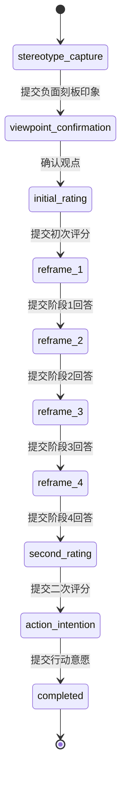
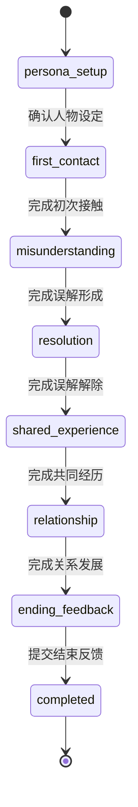

# 状态机设计

## 统一模型

会话状态包含 `path_type + stage + lifecycle + version`。状态机为纯函数：`transition(state, event, validatedData, pinnedDefinition) → result`；拒绝事件返回业务错误，无状态变更。数据库服务负责事务和持久化，模型不参与函数调用或判断。

通用生命周期：assigned → active → completed；assigned/active 可由获准退出或管理员终止事件进入 terminated。终态不可接受聊天、评分或推进；禁止通过管理员接口直接任意指定 stage。开始前校验账号、分配、已发布定义和研究要求的同意记录。

普通消息事件 `MESSAGE_SUBMITTED` 默认只保存聊天、不推进阶段。阶段转换通过 `STAGE_RESPONSE_SUBMITTED`、`VIEWPOINT_CONFIRMED`、`RATING_SUBMITTED` 等有 schema 的显式事件完成；前端只能提交当前阶段已允许的类型，后端再次验证。

若研究方案要求聊天回合数或时长触发结束，使用后端计数或服务端时间规则，并通过固定事件迁移。不能让模型返回“阶段完成=true”控制迁移。所有条件阈值需随实验版本冻结。

## 认知路径

| 当前阶段 | 通过守卫的事件 | 必须持久化的内容 |
| --- | --- | --- |
| stereotype_capture | STAGE_RESPONSE_SUBMITTED | 非空且长度合规的 stereotype_text |
| viewpoint_confirmation | VIEWPOINT_CONFIRMED | 明确确认的 confirmed_viewpoint；修改草稿仍留在本阶段 |
| initial_rating | RATING_SUBMITTED | 符合发布量表 schema 的 initial_rating |
| reframe_1…reframe_4 | STAGE_RESPONSE_SUBMITTED | 对应阶段必填回答，不能用其他阶段字段替代 |
| second_rating | RATING_SUBMITTED | 与研究定义匹配的 second_rating |
| action_intention | STAGE_RESPONSE_SUBMITTED | action_intention，保存后完成会话 |

四阶段具体干预内容尚未给出，暂用 reframe_1…4 表示，不自行命名心理学干预步骤。每阶段的目标、任务与完成标准需要研究者在实现该路径前确定。允许的当前阶段聊天不会替代评分或确认事件。

## 情感路径

默认由管理员配置并冻结 persona，参与者确认后推进；若研究要求参与者创建人物，另行定义受限 schema，不能改变实验条件。其余阶段通过明确回答/确认事件推进。误解形成与解除的刺激材料、共同经历内容、各阶段最少回合与完成标准需写入发布定义；模型不能判断“已建立关系”并跳转。

## 日常路径

`natural_chat → completed`。natural_chat 内 MESSAGE_SUBMITTED 只增加服务器计数并保存消息。默认由参与者点击结束并提交 `SESSION_END_REQUESTED` 完成；若研究方案采用固定时长或回合数，发布定义必须替换为明确的后端结束规则。

日常路径上下文仅包含中性聊天目标与 Agent 风格，不载入认知重构、误解刺激或关系干预模板。避免主动干预的语义要求还需要生成质量评估，单凭状态机不能保证。

## 路径配置的能力范围

管理员可编辑类型化路径的阶段参数、文本、量表、有限的完成策略与 Agent 分配；不能上传可执行代码、SQL、任意状态图或完整流程 Prompt。三条路径共享事件、持久化和生成框架，使用各自的阶段表与守卫。

草稿可修改，发布前验证无缺失阶段、无非法跳转、量表完整、变量 schema 完整、模板只包含当前阶段信息。运行中的会话固定到发布版本；新的配置不影响已开始的参与者。

## 必须覆盖的状态机测试

- 每条合法路径按顺序完成，阶段、变量与终态匹配。
- 当前阶段缺失必填变量、评分越界、未确认观点时拒绝迁移。
- 跳步、倒退、跨路径事件、客户端伪造条件/Agent/目标阶段被拒绝。
- 重试同一事件只产生一个效果；相同键不同载荷冲突。
- 两个相同版本的并发请求最多一个成功；状态与事件、变量保持一致。
- 模型文本包含迁移指令或伪造变量时，状态与变量保持不变。
- 中途刷新、服务重启从数据库恢复；模型失败不会丢失已提交事件。
- 完成/终止后拒绝普通事件；人工终止有权限、理由和审计；迟到回复不生效。
