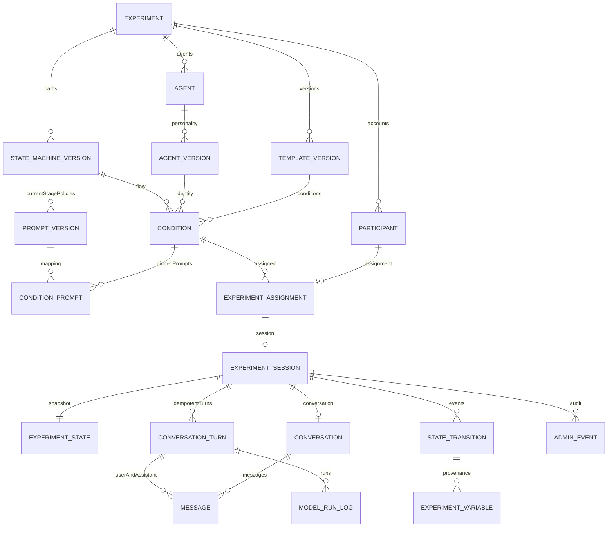

# 第十轮数据库 ER 与变量映射

本轮实际创建 19 张业务表及一个参与者消息投影视图，另有迁移账本。对应 SQL 是当前实现事实；第九轮中 generation_job、逐次尝试、账号会话和导出任务等更完整提案留待后续迁移。

图中的一对一表示目标业务关系；SQL 中 session 创建后需由服务事务补齐 state／conversation，不保证任意直接 SQL 插入都立刻完整。复合外键约束跨实验和跨会话归属；运行分配及会话绑定不可变。不同条件可绑定不同 Agent、路径版本及逐阶段 Prompt，不把完整流程写进 Prompt。

Participant.condition / assigned_agent 通过 experiment_assignment → condition → agent_version 查询，而不是在参与者表复制可漂移字段。Experiment.version/path/configuration 通过 template_version、state_machine_version 和条件追踪；Agent.name/avatar 保存在 agent，运行人格版本由 agent_version 的冻结 configuration 保存身份快照。Conversation.turn/role/content/timestamp 拆为 conversation_turn / message，保留唯一顺序和回合。

| 请求中的变量              | 当前 core／数据库映射与边界                                                               |
| ------------------------- | ----------------------------------------------------------------------------------------- |
| raw_expression            | stereotype_text；名称不证明表达是负面，不自动做语义分类                                   |
| confirmed_belief          | confirmed_viewpoint，连同 viewpoint_confirmed；只来自显式确认，不可改写                   |
| rating_1 / rating_2       | initial_rating / second_rating 分开保存，不覆盖                                           |
| action_intention          | 原 key 保留；参与者结构化提交                                                             |
| source                    | 当前 core 未采集，schema 可存合法 Scalar，但本轮不造数据或修改核心规则                    |
| character_profile         | persona_snapshot 当前为 Scalar；复杂人物对象需后续版本化扩展                              |
| scene_state / scene_phase | 当前可信 StagePolicy 来源；后续服务按绑定版本保存后端来源快照，不能采用模型输出自动落变量 |

experiment_variable 的 value 仅支持 string/number/boolean，与现有 core Scalar 对齐。来源迁移必须同会话；记录原始 key，不通过别名重写既有核心协议。state_transition 保存前后阶段、版本、事件、操作者与回执；snapshot 保留 receipts，可供新连接加载后重新验证。

Model Run Log 保存模型名、provider、Prompt 和 Validator 版本、代码提交号、耗时、重试／兜底、校验结果和安全错误码，预留 token_usage=null。模型失败不能创建 state_transition 或 experiment_variable。数据库拥有者权限很高，生产写权限与鉴权服务尚未实现，不能把 SQL schema 本身说成已完成整个业务权限系统。
