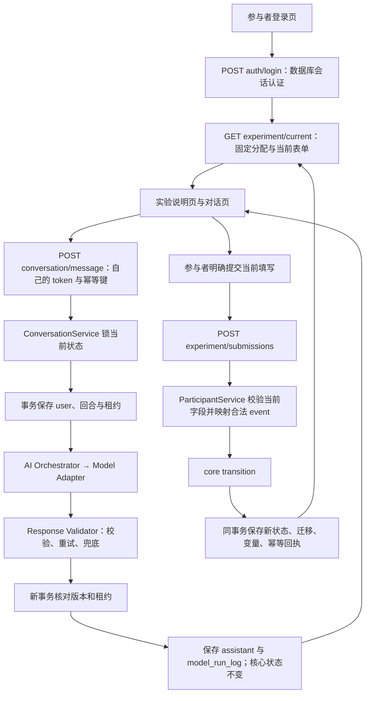

# Step 6.3：业务链路验收与最小前后端联调

日期：2026-10-11。本轮交付最小参与者页面和只读管理员页面，复用已验收后端；核心状态机、AI 编排、Model Adapter 和历史数据库 migration 不变。所有本轮模型回复均为合成 MockAdapter，非外部真实 LLM。

## 1. 业务调用流程图



说明页“开始／继续对话”只切换本地页面，不触发实验事件。模型成功不自动推进。普通聊天日志明确记录 conversation_returned_without_state_transition。

## 2. API 目录

```text
apps/api/src/
  app.ts / server.ts                 路由组合、独立数据库和安全日志输出
  controllers/routes.ts              HTTP 参数／身份／返回值，不写 SQL、不调用模型
  services/                          业务操作、状态读取与合法推进
  repositories/                      参数化 SQL 与连接／事务
apps/api/tests/
  app.test.ts                        原 health 兼容验收
  business.test.ts                   38 个真实 PostgreSQL 服务／API 验收
  restart-worker.ts                  上轮进程恢复测试辅助
apps/web/src/
  App.tsx                            参与者／管理员入口
  Participant.tsx                   登录、说明、消息、加载、明确提交与幂等重试
  Admin.tsx                          只读查询与授权 JSON 下载
  api.ts                             同源 API 调用、安全错误文案
  styles.css                         基础可读布局
apps/web/tests/browser.spec.ts        8 项真实 Chromium 页面联调
playwright.config.ts                 单 worker、无自动重试、本机或已安装 Chromium
packages/contracts/src/index.ts      参与者安全投影和管理员只读接口类型
```

未创建新架构层；这是已有 React/Vite 前端和业务后端的最小接入。

## 3. Service 层与日志

ExperimentService 创建／固定实验、条件、Agent 和版本，负责分配初始化。ParticipantService 创建账号、数据库会话认证、自己的状态、合法明确事件提交。ConversationService 负责消息幂等、生成租约、校验结果保存和恢复。ModelRunService 核对固定模型配置后调用编排。AdminService 验证管理员后查询／审计导出。

新增 services/trace.ts 是轻量可选诊断回调。server.ts 将 business_trace 结构化 JSON 写到后端标准输出。步骤包括：login_authenticated、participant_authenticated、assignment_and_state_loaded、conversation_state_loaded、user_message_committed、orchestrator_started、model_adapter_called、response_validator_completed、assistant_and_model_log_committed、conversation_returned_without_state_transition，以及 explicit_event_validated／state_event_variables_committed。重放用独立 replay marker，不虚报再次迁移。生成步骤由 participantId／sessionId／turnId 关联；显式提交 operationId 为 request_id 的规范化哈希。

诊断日志不含密码、Bearer token、输入文本、Prompt 或变量值，日志回调失败不改变实验操作结果。[实际安全日志](acceptance/step6-round13/business-trace.json)和[浏览器链路日志](acceptance/step6-round13/browser-business-trace.json)来自本轮执行。标准输出日志不是持久审计数据库；关键结果仍保存在消息、model_run_log、state_transition、experiment_variable、admin_event。生产日志收集／保留策略尚未部署。未执行的非法操作依靠 HTTP 结果和测试报告验收，不伪造生成成功日志。

## 4. Repository 层与缓存恢复

ExperimentRepository 保存固定配置与版本；ParticipantRepository 保存账号／会话／分配；StateRepository 保存权威快照、事件、变量和回执；ConversationRepository 保存消息／日志，并提供限量追溯导出；UnitOfWork 管理连接和原子事务。

服务不使用运行缓存作为状态源。本轮丢弃服务实例，使用新的 PostgreSQL Pool／Service 恢复身份、Agent／Prompt 版本、消息、当前状态和 source 等变量；见 [新连接恢复证据](acceptance/step6-round13/database-restoration.json)。真实浏览器 reload 后登录，仍从数据库取回已推进状态与对话。上一轮 SIGKILL 子进程恢复测试继续在全量检查中执行。本轮没有演练数据库主机断电或删除数据库文件。

## 5. 数据库写入与变量示例

浏览器发送聊天：user／assistant 共 2 条 message，1 条 model_run_log；仍只有 assignment-start 一次 state_transition。随后明确提交：

```json
{
  "request_id": "浏览器生成并保留的 UUID",
  "state_token": "当前接口返回的随机 UUID",
  "data": { "response": "浏览器明确提交的表达", "source": "浏览器明确填写的来源" }
}
```

新增 STEREOTYPE_SUBMITTED 迁移，状态进入 VIEWPOINT_CONFIRMATION(version=2)；stereotype_text、raw_expression、source 同事务写入并引用同一 source_transition_id。样例见 [浏览器参与者记录](acceptance/step6-round13/browser-participant-records.json)。

认知完整浏览器流程保存 raw_expression、confirmed_belief、source、rating_1、rating_2、action_intention，共 9 个语言回合、18 条消息、10 次合法迁移、9 个模型日志。情感完整流程保存 character_profile、scene_state、scene_phase、relationship_state，共 7 个语言回合、14 条消息、8 次迁移、7 个模型日志。完整记录见 [认知](acceptance/step6-round13/browser-cognitive-complete.json)与[情感](acceptance/step6-round13/browser-emotion-complete.json)。这仍是工程策略与合成数据，不代表正式量表或场景语义通过。

source 在首次捕获表单明确展示为选填，其他阶段不出现；兼容 v1，不猜测来源。scene_state／character_profile 仍是显式文本，scene_phase 来源于后端合法 event.toStage，补充研究键仍在变量表，不改核心 snapshot 键。

## 6. 完整消息请求与客户端恢复

先登录：POST /api/auth/login，JSON 包含 experiment_id、participant_code、password；取返回 token，仅保存在当前页面内存。随后 GET /api/experiment/current 和 /api/conversation/messages，显示说明与自己的记录。

```http
POST /api/conversation/message
Authorization: Bearer <登录返回的 token>
Content-Type: application/json
```

```json
{
  "request_id": "客户端生成的 UUID",
  "state_token": "当前表单随机 UUID",
  "text": "浏览器参与者输入"
}
```

ready 时返回 turn_id、status、通过校验的 text，再刷新自己消息与状态。generating 状态通过自己的回合接口每秒查询，结束后刷新；查询不产生事件。生成失败显示可重试提示，变量和核心状态不变。

网络丢失回复时，客户端保留原 request_id／state_token／payload，提供“重试同一消息”；提交丢失回复时提供“重试同一提交”，不重新生成幂等键。已确定失败后新操作才用新键。浏览器测试实际丢弃已落库的 HTTP 回复，再点击重试，断言消息仍只有两条、模型仅调用一次，或状态只迁移一次。

账号 token／管理员原始凭据不写 localStorage、sessionStorage、URL 或导出。刷新或切换入口需要重新登录；实验本身不丢失。参与者“退出登录”撤销当前数据库会话；管理员“退出后台”只清空本页凭据。当前不提供持久的浏览器登录状态、多管理员账号或账号创建 UI。

## 7. 状态与并发验收

合法：INIT → STEREOTYPE_CAPTURE（backend 初始化）；明确响应提交后 STEREOTYPE_CAPTURE → VIEWPOINT_CONFIRMATION。聊天成功不会改变 core_version。

非法：错误当前字段／注入 event、state、variables 或其他身份拒绝；终态不能继续推进。两个不同 request_id 使用同一 state_token 并发提交，只有一个 200，另一个 409；只有一个提交回执、一组新变量、一次新迁移。同键同内容重放原结果，同键不同内容冲突。参与者不能越权查看别人的回合、消息或管理员数据，且不能任意修改阶段。

## 8. 测试、图片与启动

本轮 Vitest 380 passed／0 failed／0 skipped，15 个文件；Playwright 8 passed／0 failed／0 skipped，共 388 项实际测试。业务服务／API 38 项，其中本轮新增 3 项并发、日志与新 Pool 恢复验收。真实浏览器覆盖登录、说明、消息、认知／情感完整路径、加载／生成失败、两种网络重放、页面刷新、管理员查询、授权下载和错误提示。

[Vitest 报告](acceptance/step6-round13/test-results.json)、[浏览器报告](acceptance/step6-round13/browser-results.json)、[汇总](acceptance/step6-round13/summary.json)。浏览器使用本环境 Chromium 154.0.8037.57，经 Vite 同源代理访问真实 Express 和临时 PostgreSQL 17.7，生成回复使用 MockAdapter，外部模型调用为 0。

GitHub 可查看／下载真实页面截图：[登录](acceptance/step6-round13/participant-login.png)、[参与者对话](acceptance/step6-round13/participant-chat.png)、[只读后台](acceptance/step6-round13/admin-read-only.png)。均为合成账号运行截图，不是生成图。ZIP 包含所有 PNG。

普通复现 npm ci、npm run check；需要 Docker 和 Chromium。本机 /usr/bin/chromium 存在时自动使用，也可设置 CHROMIUM_EXECUTABLE_PATH；否则预先 npx playwright install --with-deps chromium。CI 已追加该安装步骤，未宣称本轮 GitHub Actions 已执行成功。npm run test:browser 单独复现真实浏览器测试，默认报告在 /tmp；不自动改提交的验收文件。

更新验收文件须显式执行：

```bash
mkdir -p docs/acceptance/step6-round13
ROUND13_ACCEPTANCE_DIR=docs/acceptance/step6-round13 npm test -- --reporter=json --outputFile=docs/acceptance/step6-round13/test-results.json
ROUND13_ACCEPTANCE_DIR=docs/acceptance/step6-round13 BROWSER_REPORT_PATH=docs/acceptance/step6-round13/browser-results.json npm run test:browser
```

实际操作页面：安全配置独立 DATABASE_URL 和 ADMIN_ACCESS_TOKEN_HASH、显式 npm run db:migrate -- up；两个终端分别 npm run dev:api 与 npm run dev:web。创建实验／条件／账号仍用上一轮管理员 API，页面只有查询和参与者操作。没有预置生产账号，启动不迁移、不连接 WorkBuddy。Vite 默认端口 5173，API 3001，仅本地开发；不提供未经部署的公网实验地址。

## 9. 当前阻塞与边界

缺少已验收真实模型、正式量表／研究策略和外部持久数据库；本轮未部署。旧 health 的 mode=scaffold 仅为兼容，不能判断实验就绪。管理员导出仍 complete=false、最多每类 1000 条，页面明确显示限制；无全量分页／CSV／ZIP 导出任务。消息显示也受 1000 条限制。

UI 仅最小功能：无复杂动画、高级权限、创建配置页面或人工改变 state。浏览器刷新需重新登录。source 兼容可选、场景文本还不是正式 JSON schema，模型供应商修订号／token_usage 未采集。运行日志不是生产日志平台，进程内限流、单一 bootstrap 身份、无后台生成队列、无数据库 RLS／生产备份演练等既有问题仍待完成。当前工程联调通过不等于正式实验上线许可。
