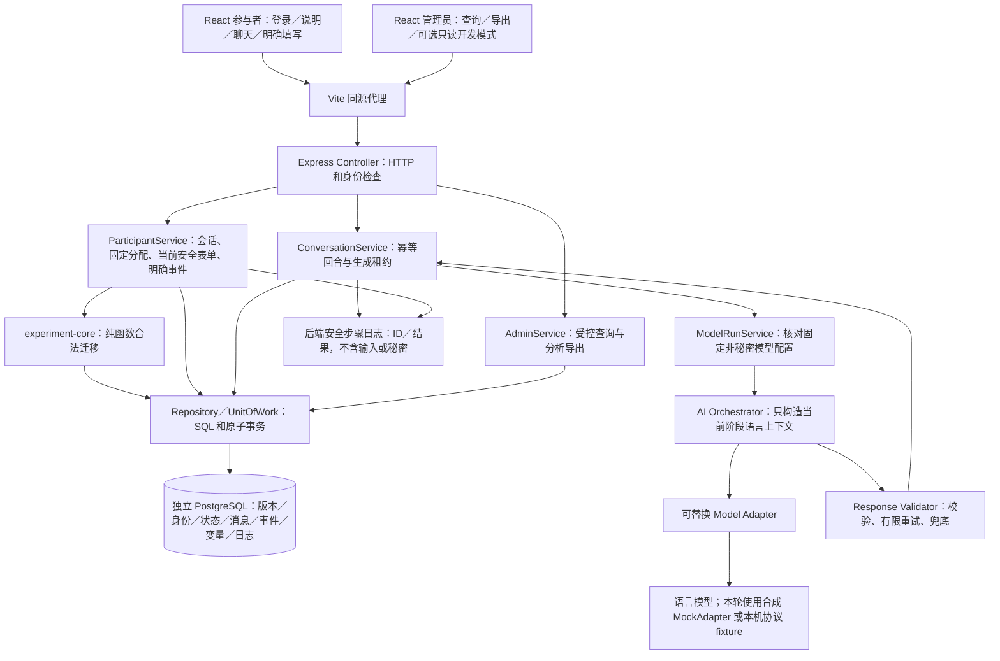

# 第十四轮：完整业务闭环、恢复与分析导出

日期：2026-10-11。本轮只补强可用性、分析追溯和管理员只读诊断。纯状态机、AI 编排、模型 Adapter、已发布 v1 定义及 001／002／003 migration 未修改。

## 1. 完整系统架构



开发模式没有状态修改路径，也不改变模型、Prompt 或实验变量。后端功能只连接显式配置的独立数据库；所有验收容器使用合成参与者，不涉及 WorkBuddy。

## 2. 前后端调用与信息边界

参与者 POST /auth/login 获取随机会话 token，仅放页面内存。GET /experiment/current 读取固定分配、说明、Agent 展示名、opaque state_token、当前表单；GET /conversation/messages 读取自己的就绪消息。

POST /conversation/message 携带 request_id、state_token、text。服务认证／锁自己的会话 → 保存一个 user、一个 assistant 占位和回合 → 提交事务 → 编排／Adapter／Validator → 新事务核对核心版本、聊天版本和租约 → 保存通过校验的回复／安全模型日志 → 前端刷新。聊天不创建状态事件。

POST /experiment/submissions 是独立明确操作：服务根据当前后端表单映射合法 event → core.transition → 同事务保存状态、事件、变量、研究别名和幂等回执。AI 无权触发这个操作。

同 request_id 同内容重放原结果，同键异内容 409；每个已接受回合只有一个 user 和一个 assistant 槽位。模型可能进行有限重试，但不会因此增加消息或阶段迁移。失败回合 assistant 是 failed/null，不能声称每次失败都有自然语言回复。不同 request_id 是不同操作；不承诺跨键文本去重或供应商恰好一次收费。

参与者接口与页面没有 state 名、event 名、Validator、Prompt 或 model_run_log。后台诊断在另一个管理员接口，启用后也不改变参与者投影。原有安全步骤日志逐步记录身份、分配／状态、user 保存、编排、Adapter、Validator、assistant／日志保存和明确事件提交；见 [本轮步骤证据](acceptance/step6-round14/business-trace.json)与[浏览器日志](acceptance/step6-round14/browser-business-trace.json)。标准输出不是生产持久日志平台，关键审计仍在数据库。

本轮新增可用性：页面明确显示正在处理／可以继续／已完成；消息框显式 label 关联，保留草稿后仍可稳定操作。明确 4xx 拒绝会释放消息重试锁；网络／5xx 等未确定结果继续保留原幂等键。管理员采用同步运行锁避免重复按钮操作，切换／退出时清理诊断数据。消息按数据库 sequence 展示，导出事件／变量有稳定版本排序。

## 3. Participant 完整验收

真实 Chromium 经 Vite 代理调用 Express／Service／Repository／临时 PostgreSQL，页面数据没有以 mock API 替换。模型回复为合成 MockAdapter。

- 登录、固定分配、说明、历史消息、发送和回复显示通过。
- 认知路径完整运行 9 个语言回合，18 条消息、10 次迁移、9 个模型日志；raw_expression、confirmed_belief、source、rating_1、rating_2、action_intention 全部持久化。
- 情感完整运行 7 个语言回合，14 条消息、8 次迁移、7 个模型日志；character_profile、scene_state、scene_phase、relationship_state 全部持久化。
- 页面 reload 后重新登录恢复当前阶段和历史，不从 INIT 重启。
- 网络丢失已落库回复后同键重放，模型只生成一次；提交同键重放只迁移一次。
- 快速双击发送只创建 user／assistant 两个槽位，sequence=1／2；聊天不推进状态。
- 另一个页面已推进后，旧 state_token 消息被拒绝，刷新即可恢复新状态，不被旧重试键永久锁住。
- 在 version=2 且 source 已保存时模型失败，reload／新消息恢复后仍 version=2，来源不丢失。
- 开发模式启用的服务器仍拒绝参与者读取诊断，页面无内部阶段／事件／Prompt／模型字段。

数据证据：[认知](acceptance/step6-round14/browser-cognitive-complete.json)、[情感](acceptance/step6-round14/browser-emotion-complete.json)、[参与者操作](acceptance/step6-round14/browser-participant-records.json)。截图：[登录](acceptance/step6-round14/participant-login.png)、[对话](acceptance/step6-round14/participant-chat.png)。均为实际浏览器合成数据截图。

## 4. Admin 完整验收与 Development Mode

只读管理员页面查询实验、参与者、条件、当前状态和按序对话，并实际下载授权 JSON；不提供状态干预或修改已发布配置的页面。

新增 GET /api/admin/capabilities，认证后返回 development_mode。新增 GET /api/admin/development?experiment_id=…，同时要求管理员认证和显式启用，否则未认证／参与者 401，默认关闭时管理员 404。ADMIN_DEVELOPMENT_MODE 默认 false，只接受 true／false；云环境草稿建议 false。

页面“开发模式（仅管理员）”默认未勾选，服务关闭时禁用。明确勾选才读取 states／events／variables／model_runs，显示只读诊断。查询保存 DEVELOPMENT_VIEWED 审计事件，但不修改任何实验状态、消息、变量或模型配置。退出／切换实验清理旧诊断；数据来自当前选择实验的限量一致快照。无 PATCH／人工 state 操作。

本轮真实浏览器 fixture 为测试诊断显式启用该标志；普通服务器启动仍默认关闭。接口测试分别验证默认关闭、越权拒绝、参与者投影隔离和只读审计。[开发接口证据](acceptance/step6-round14/development-api.json)、[浏览器诊断关联记录](acceptance/step6-round14/browser-development-records.json)、[开发模式真实截图](acceptance/step6-round14/admin-development.png)、[普通只读后台](acceptance/step6-round14/admin-read-only.png)。

## 5. 面向心理学分析的导出

保留 research-json-v1 原顶层数组，新增 analysis_schema=participant-research-v1、analysis_rows。每行按固定 assignment／session 关联一个参与者，不混入其他人的记录：

```json
{
  "participant_id": "合成参与者 UUID",
  "experiment_id": "合成实验 UUID",
  "condition": "A",
  "condition_id": "已发布条件 UUID",
  "path_type": "cognitive",
  "agent_version": {
    "id": "固定 Agent UUID",
    "version": "1",
    "configuration": { "name": "研究对话助手" }
  },
  "prompt_version": [
    { "stage": "后端阶段", "id": "固定 Prompt UUID", "version": "stage-language-v3-内容哈希" }
  ],
  "model_version": {
    "requested_model": "browser-synthetic-model",
    "provider": "mock",
    "supplier_revision": null
  },
  "timestamp": { "assigned_at": "实际数据库 ISO 时间", "exported_at": "实际导出 ISO 时间" },
  "current_state": {},
  "state_transition": [],
  "conversation_history": [],
  "experiment_variables": [],
  "model_runs": []
}
```

以上是字段说明占位；[真实本轮合成导出](acceptance/step6-round14/analysis-export.json)包含实际 UUID／时间／数组。参与者级记录还有 assignment_id、session_id、state_machine_version、template_version_id 和 model_settings。Prompt 数组是固定版本清单，实际使用由 model_runs.prompt_version_id 追溯。消息和事件的 created_at 是各自记录时间，变量有来源迁移、key／revision／recorded_stage；source 只能明确填写，不推断。

model_version.requested_model 记录固定请求模型名；供应商独立修订号未采集，supplier_revision 明确为 null，不伪造。path_type 使用现有 cognitive／emotional／daily 枚举。character_profile／scene_state 仍是显式文本，scene_phase 为后端 event.toStage；正式复杂世界状态 schema 尚未定义。

导出仍 complete=false、每类最多 1000 条，analysis_rows 只聚合这批限量数据，不能保证全量研究归档。页面明确提示限制。无 CSV／分页／后台 ZIP 导出任务；不是为了满足字段要求而隐藏数据截断。[浏览器实际下载样例](acceptance/step6-round14/browser-admin-export.json)排除密码与会话摘要。

## 6. 恢复、配置与测试结果

当前报告确认：页面刷新、新 Pool／Service 恢复、真实 API 子进程 SIGKILL／重新启动、生成失败、网络中断、重复消息、并发明确提交、过期／迟到保护及变量写入失败回滚全部通过。恢复不回退核心版本，之前合法填写的变量不丢失。[本轮进程恢复](acceptance/step6-round14/process-recovery.json)、[新连接恢复](acceptance/step6-round14/database-restoration.json)、[浏览器失败后恢复](acceptance/step6-round14/browser-recovery-records.json)。SIGKILL 测试为避免等生产租约，显式把已保存 deadline 设置到过去，不是数据库主机断电演练。

配置链 Experiment → 已发布 Condition → Agent Version／Prompt Version／State Machine Version 固定保存在 assignment；研究说明和各阶段 policy 可明确配置。新增不同实验／策略后，旧完成实验的 assignment、状态、Prompt 和迁移完全相同，冻结配置拒绝修改。不是在完整 Prompt 中写流程；当前阶段策略只负责语言。当前 API 创建 draft v1 和新实验，尚无同实验多模板版本管理 UI 或任意状态机设计 UI。

实际结果：Vitest 384 passed，0 failed，0 skipped，15 个文件；业务服务／API 42 项，本轮新增 4 项。Playwright 12 passed，0 failed，0 skipped，本轮新增 4 项。合计 396 项。相关报告：[Vitest](acceptance/step6-round14/test-results.json)、[浏览器](acceptance/step6-round14/browser-results.json)、[分项恢复结果](acceptance/step6-round14/recovery-results.json)、[汇总](acceptance/step6-round14/summary.json)。所有外部真实模型调用为 0；真实 PostgreSQL 17.7、Chromium 154 和 HTTP 链路已经运行。

普通复现 npm ci、npm run check，需要 Docker 与已安装 Chromium。单独 npm run test:browser。显式更新本轮验收：

```bash
mkdir -p docs/acceptance/step6-round14
RESEARCH_ACCEPTANCE_DIR=docs/acceptance/step6-round14 npm test -- --reporter=json --outputFile=docs/acceptance/step6-round14/test-results.json
RESEARCH_ACCEPTANCE_DIR=docs/acceptance/step6-round14 BROWSER_REPORT_PATH=docs/acceptance/step6-round14/browser-results.json npm run test:browser
```

业务开发仍需独立 DATABASE_URL、显式 npm run db:migrate -- up，以及 ADMIN_ACCESS_TOKEN_HASH；两终端 dev:api／dev:web。开发模式仅需非秘密 ADMIN_DEVELOPMENT_MODE=true，但正式参与者环境保持 false。启动不加载 .env、不自动迁移、不创建生产账号、不调用收费模型做验收。

## 7. 已知问题

未完成外部真实模型／研究者语义审核、正式量表、外部持久数据库或部署。合成模型通过不证明真实 LLM 可靠。仍为单一 bootstrap 管理员、进程内登录限流、无生产 RLS／备份演练／后台生成队列。过期恢复依赖访问或生成完成，尚无主动调度，不自动重复付费。

source 为 v1 兼容选填；历史别名不回填。场景／人物文本尚不是正式结构化研究 schema。模型供应商修订号和 token_usage 未采集。Agent 当前可固定名称、阶段角色描述／策略，完整 Agent 配置编辑及同实验新模板版本服务尚待开发。导出限量、消息无分页，正式全量归档仍是阻塞项。

开发模式是受控诊断，不是生产日志或高级权限系统；开启后 bootstrap 管理员可查看该平台全部被授权查询实验的内部数据。参与者浏览器刷新需重新登录，但实验在数据库恢复。没有把本轮工程可用性验收当作正式实验上线许可。
