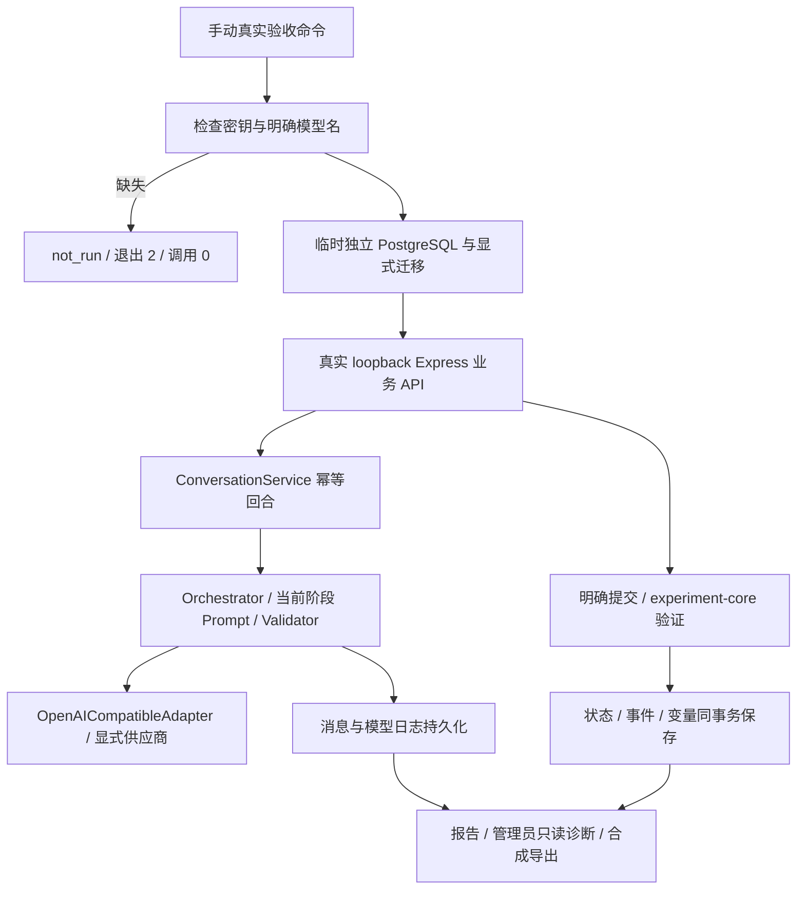

# 第十六轮：真实业务验收入口与部署前准备

日期：2026-10-11（北京时间）。根据[原始要求](inputs/sixteenth-round-requirements.docx)，本轮补齐真实供应商通过业务 API／状态机／PostgreSQL 的完整验收入口，并重新执行本机专项与稳定性回归。核心状态机、编排、Adapter、migration 和前端交互逻辑未改。

## 1. 真实模型测试报告

实际执行 npm run live:business:e2e，退出码 2。报告 status=not_run，缺 MODEL_API_KEY 和 MODEL_NAME；Adapter 调用 0、外部调用 0、数据库未启动。环境 draft 的密钥需求已存在但无绑定，不能把声明当有效配置。当前没有外部 DATABASE_URL 或管理员凭据配置。[真实报告](acceptance/step6-round16/real-model-business-report.json)保留实际未运行状态；延迟／重试／校验／兜底为 null，没有测量。

新增 runBusinessAcceptance 接收显式 generator／settings 和调用者的隔离 Pool，真实命令选择实际 OpenAI 兼容 Adapter。正常流程使用真实 HTTP API 登录／消息／明确提交／重放／刷新查询／管理员诊断及导出；ModelRunService 校对固定模型参数，经 Orchestrator／Validator 保存日志。模型只生成语言，状态只由合法明确提交推进。旧 live:e2e 只含模型／core 合成流程，新入口补齐业务与数据库。

报告包含固定 model_name、provider、temperature、max_tokens；每条 model_run_log 包含 latency_ms、retry_count、validator_result、fallback_count、错误码和 Prompt 版本；每路径有 p50／p95／max 与工程门槛。供应商修订号及 token_usage 仍未知，不伪造。

本机实际协议服务运行相同函数，18 次 HTTP Adapter 生成完成两条路径，external_model_calls=0。那是入口验证，不是已验收真实模型。另有 36 次合成违规生成的 guarded 报告、2 次失败尝试和 2 次取消超时的失败报告；不会用兜底掩盖模型失败。[本机完整链路](acceptance/step6-round16/local-business-acceptance.json)、[违规拦截](acceptance/step6-round16/guarded-business-acceptance.json)、[失败](acceptance/step6-round16/failed-business-acceptance.json)、[取消超时](acceptance/step6-round16/timeout-business-acceptance.json)。

验收发现原型入口曾将 JSON 字段顺序当成内容差异；现使用内容深比较，兼容 PostgreSQL jsonb 回执的字段排序，重放不增加调用或推进。新增延迟门槛故障测试，使用刻意极小门槛确保得到 latency_threshold_exceeded，而非无条件判定速度通过。[门槛测试](acceptance/step6-round16/latency-gate-acceptance.json)。这不是修改实验变量或状态规则。

## 2. Acceptance checklist

[完整清单](experiment-acceptance-checklist.md)涵盖环境（Node／数据库／变量／模型）、功能（登录／分配／聊天／明确推进／保存／导出）和异常（断网／失败／重复／刷新／重启）。[机器清单](acceptance/step6-round16/experiment-acceptance-checklist.json)分别记录工程 passed 与正式 not_run／blocked。

新真实入口在配置齐全后会产生服务商用量；18 个正常语言回合、默认最多 36 次 Adapter 调用，上限 54。它忽略外部 DATABASE_URL，只用合成临时库，不在正式库运行。报告可保存 /tmp，未来有实际调用时先研究者审核，再脱敏留存。保存环境草稿不绑定密钥、不部署、不自动运行真实验收。

## 3. 认知路径专项结果

本机 HTTP 完成 STEREOTYPE_CAPTURE → VIEWPOINT_CONFIRMATION → INITIAL_RATING → 四个 REFRAME → SECOND_RATING → ACTION_INTENTION → COMPLETED。9 次明确提交、10 次语言回合（评分中断额外 1 次）、20 消息、10 模型日志、10 次含初始化迁移。

confirmed_belief 只有一条，固定为合成参与者明确确认的表达；rating_1／rating_2 与该固定表达处于同一 assignment／session。四个 reframe_response 全部保存。评分中断不改变核心 snapshot、事件或变量，随后仍由明确表单合法推进；消息和提交同键重放均不产生额外生成或迁移。

上述能验证结构与固定对象，不足以证明真实模型没有生成新观点或评分暗示。实际供应商尚未运行，真实模型认知专项标记 not_run，研究者语义审核 pending。[专项结果](acceptance/step6-round16/cognitive-special-acceptance.json)、[本轮浏览器完整路径](acceptance/step6-round16/browser-cognitive-complete.json)。

## 4. 情感路径专项结果

本机 HTTP 完成 PERSONA_SETUP → FIRST_CONTACT → MISUNDERSTANDING → RESOLUTION → SHARED_EXPERIENCE → RELATIONSHIP → ENDING_FEEDBACK → COMPLETED。7 次明确提交、8 次语言回合（询问规则额外 1 次）、16 消息、8 模型日志、8 次含初始化迁移。

规则询问不改变已保存 scene_state／scene_phase／人物／事件；仅合法明确提交更新研究别名。每次聊天均检查 snapshot、变量、事件不变。原有五类改剧情／提前结束／跳场景／极短回复／询问规则测试重新通过。

“没有剧情回溯”“没有提前透露结局”属于语言语义结论，本机固定回复不能证明真实模型符合实验设计。真实模型情感专项为 not_run。[专项结果](acceptance/step6-round16/emotional-special-acceptance.json)、[本轮浏览器完整路径](acceptance/step6-round16/browser-emotion-complete.json)。

## 5. 数据导出与管理员诊断

analysis_rows 包含 participant_id、experiment_id、condition、agent_version、prompt_version、model_version、conversation_history、state_transition、experiment_variables。为匹配本轮明确要求，增加 model_run_log，与既有 model_runs 是同一批本会话模型记录的兼容别名，不增加模型调用／表／独立日志内容。

8 类 SQL 完整性检查重新执行：会话无状态、消息无状态、状态／事件版本不对应、事件链间隙、变量无合法来源、消息槽位不足、ready 无有效回复、ready 无模型日志。正常合成导出计数均 0，故障注入必须 reported false；无来源或篡改历史继续被外键／不可变触发器拒绝。[正常样例](acceptance/step6-round16/analysis-export.json)、[浏览器实际下载](acceptance/step6-round16/browser-admin-export.json)、[故障注入](acceptance/step6-round16/integrity-fault-injection.json)。

仍 complete=false、每类最多 1000 条。当前小样例可以分析字段映射，但不能宣称导出已足够正式全量研究分析。正式无截断归档、完整资源版本包及研究 schema 尚待完成。

管理员只读模式保持默认关闭；已认证管理员显式开启后可查看 current_state／event／variable／latency／validator_result／异常，参与者接口和页面不显示内部数据。diag state_after 是依据迁移与模型日志 created_at 的重建，不是精确事务提交顺序。没有状态干预功能。[实际管理员截图](acceptance/step6-round16/admin-stability.png)、[只读诊断](acceptance/step6-round16/debug-log.json)。

## 6. 压力与恢复结果

本轮重新运行三路径各 30 轮约 3600 字输入、同一实验 6 人各 5 轮并发，共 120 个本机合成压力回合／240 槽位。核心 snapshot／确认观点／场景不漂移，消息 sequence 连续，账号之间没有混入历史。阶段历史仍最多 6 条、每条截取 800 字符，数据库保存原输入，未将完整流程放进 Prompt。

新增真实浏览器连续 3 次 reload／重新登录：assignment、state、source、消息顺序、事件均与刷新前完全相同，没有重复推进。已有断网重放、双击、超时、服务 SIGKILL／重启、新 Pool 恢复重新验收。[多次刷新](acceptance/step6-round16/browser-multiple-refresh-records.json)、[压力结果](acceptance/step6-round16/stress-results.json)、[进程恢复](acceptance/step6-round16/process-recovery.json)、[恢复汇总](acceptance/step6-round16/recovery-results.json)。

压力都是本机 MockAdapter／协议 fixture，没有真实 20–30 轮持续供应商调用、正式额度或目标规模容量结论。工程默认 10000ms 门槛不是正式体验标准。

本轮实际测试：407 Vitest、14 Playwright，合计 421 passed，0 failed／skipped；业务 API 65 项，本轮新增 6 项 API／服务、1 项浏览器用例。[测试](acceptance/step6-round16/test-results.json)、[浏览器](acceptance/step6-round16/browser-results.json)、[汇总](acceptance/step6-round16/summary.json)。

## 7. 当前阻塞

缺 MODEL_API_KEY／明确 MODEL_NAME，真实供应商没有调用；没有独立持久 DATABASE_URL、正式管理凭据或目标 HTTPS 部署。正式量表、必填来源、结构化场景、拒答与自愿退出方案、全量导出、备份恢复、目标规模持续压力与运维权限尚未验收。

已知边界保留：单一 bootstrap 管理员、进程内限流、无主动后台恢复队列／消息分页、未知供应商修订和 token_usage。同实验多模板版本管理及完整 Agent 编辑器未实现。不能把 schema 结构检查或模型文字规则当正式研究设计签核。

## 8. 是否达到正式实验条件

**否。** 当前具备可运行的真实业务验收入口和通过的本机工程回归；真实模型专项 not_run，研究者语义审核 pending，正式环境和全量归档仍阻塞。本轮不构成上线或正式招募许可。

下一步先在安全环境设置配置模型需求，再手动执行新入口并审核真实报告；并行明确正式研究量表／退出流程、全量归档及目标环境验收，不优先扩大 UI 或改核心状态机。
